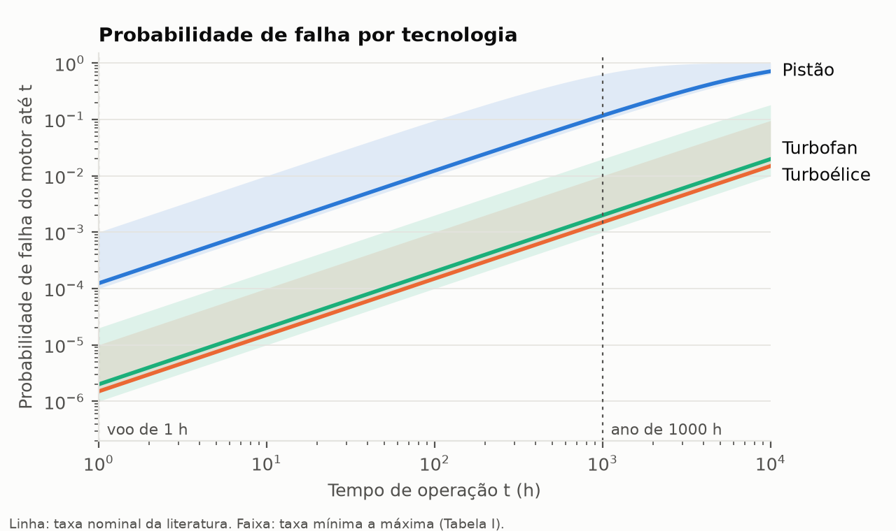
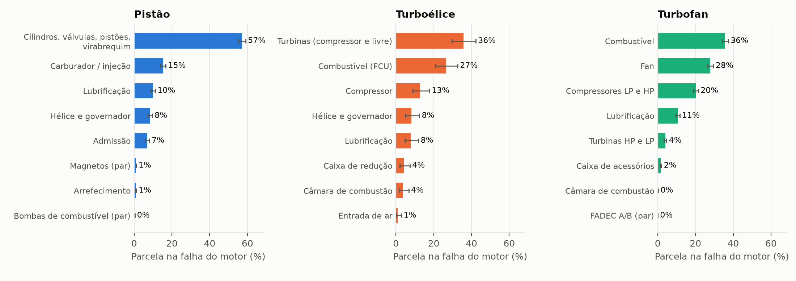
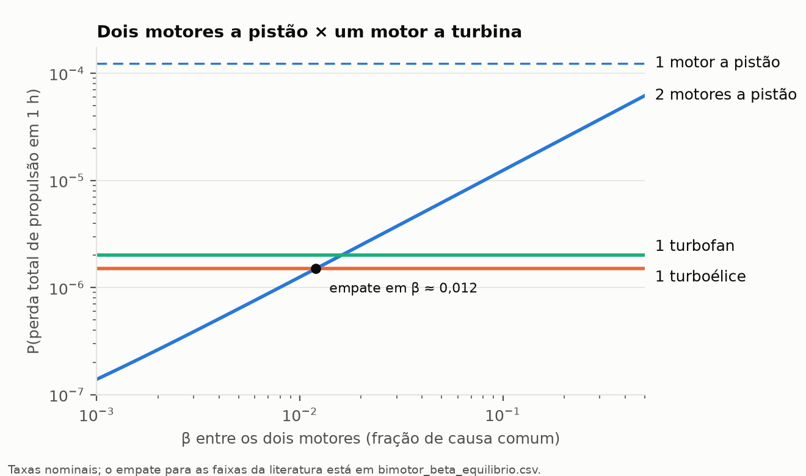
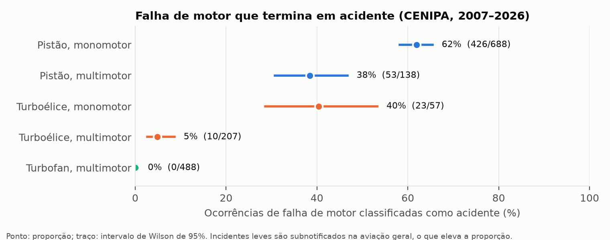
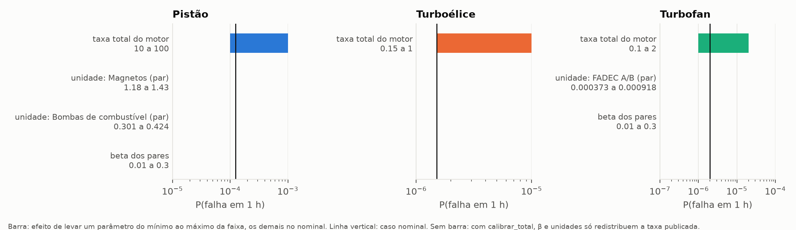

# Confiabilidade de motores aeronáuticos: pistão, turboélice e turbofan

Resultados do modelo de diagrama de blocos de confiabilidade (RBD) para os três motores. As taxas totais vêm da literatura (Tabela I da proposta). As frações por subsistema e as taxas das unidades redundantes foram estimadas pelas contagens de três fontes: os relatórios finais do CENIPA, o SDRS (FAA) e os achados do NTSB. As tabelas citadas estão em `saida/tabelas/`.

## 1. Resultados

A Tabela 1 reúne as métricas de cada motor (`metricas_motores.csv`). A taxa publicada é preservada em um voo de 1 h (`calibrar_total: true`), então a taxa equivalente do modelo coincide com a da literatura.

**Tabela 1 – Métricas por motor (taxas nominais)**

| Motor | λ (falhas por 10⁵ h) | MTBF sem reparo (h) | MTBF, par restaurado a cada voo (h) | P(falha em 1 h) | Faixa de P(falha em 1 h) | R(1000 h) |
|---|---|---|---|---|---|---|
| Pistão (Lycoming O-540) | 12,4 | 7 945 | 8 065 | 1,24 × 10⁻⁴ | 1,0 × 10⁻⁴ a 1,0 × 10⁻³ | 0,883 |
| Turboélice (PT6A-34) | 0,15 | 666 667 | 666 667 | 1,5 × 10⁻⁶ | 1,5 × 10⁻⁶ a 1,0 × 10⁻⁵ | 0,9985 |
| Turbofan (CFM56-7B) | 0,20 | 499 993 | 500 000 | 2,0 × 10⁻⁶ | 1,0 × 10⁻⁶ a 2,0 × 10⁻⁵ | 0,9980 |

Com as taxas nominais, o motor a pistão tem 83 vezes a probabilidade de falha do turboélice em um voo de 1 h, e 62 vezes a do turbofan. Em um ano de 1000 h, a chance de pelo menos uma falha é de 12% no pistão e de 0,15% a 0,20% nos motores a turbina. A diferença não depende do valor nominal escolhido: mesmo no mínimo da faixa (10 por 10⁵ h), o pistão falha 5 vezes mais que o turbofan e 10 vezes mais que o turboélice no máximo das faixas deles.

Entre os dois motores a turbina, o modelo não estabelece uma ordem. O turbofan tem taxa nominal um pouco maior, mas as faixas se sobrepõem quase por inteiro (0,15 a 1 contra 0,1 a 2 por 10⁵ h).

A redundância interna pouco altera o comportamento ao longo do tempo. No pistão, a taxa equivalente sobe de 12,40 para 12,41 por 10⁵ h entre 1 h e 1000 h. Por isso os dois MTBF da tabela ficam próximos.

*Figura 1 – Probabilidade de falha até t. Linha: taxa nominal; faixa: taxa mínima a máxima da literatura.*

## 2. Subsistemas

A Tabela 2 e a Figura 2 mostram a parcela de cada bloco na falha do motor em um voo de 1 h (`pareto_blocos.csv`). As faixas são o intervalo de 95% da fração medida (Jeffreys). Elas refletem só a incerteza amostral das contagens, não o viés das fontes.

**Tabela 2 – Blocos que somam mais de 75% das falhas**

| Motor | Registros nos blocos em série | Primeiro | Segundo | Terceiro | Soma dos três |
|---|---|---|---|---|---|
| Pistão | 2 387 | Cilindros, válvulas, pistões, virabrequim: 57% (55–59%) | Carburador / injeção: 15% (14–17%) | Lubrificação: 10% (9–11%) | 82% |
| Turboélice | 218 | Turbinas: 36% (30–42%) | Combustível (FCU): 27% (21–33%) | Compressor: 13% (9–18%) | 75% |
| Turbofan | 3 170 | Combustível: 36% (34–37%) | Fan: 28% (26–29%) | Compressores LP e HP: 20% (19–22%) | 84% |

**Pistão.** O núcleo mecânico (cilindros, válvulas, pistões, virabrequim) responde por mais da metade das falhas. Com carburador/injeção, lubrificação, hélice e admissão, os cinco blocos em série chegam a 98%. Os pares redundantes ficam no fim do Pareto: magnetos com 1,0% e bombas com 0,3%.

**Turboélice.** É o motor com menos dados (218 registros). Os intervalos são os mais largos dos três: o bloco das turbinas vai de 30% a 42%.

**Turbofan.** A distribuição medida difere bastante da estimativa inicial (`fracoes_posteriori.csv`). O fan passou de 8% para 28%, e as turbinas caíram de 20% para 4%. O FADEC, que antes dominava o Pareto com a taxa assumida, fica com 0,03% quando sua taxa é estimada pelas contagens (seção 3).

A parcela de 28% do fan não representa falhas do fan. Para conferir, foi lida a ficha completa de uma amostra de 101 dos 883 registros de fan do SDRS, sorteada em proporção ao número de registros de cada ano (`data/raw/sdrs/amostra_fan_cfm56_7.json`). O resultado:

- **Achados de manutenção programada.** 94 dos 101 registros foram encontrados em inspeção ou manutenção, com a aeronave no solo. Pelo menos 71 citam um cartão de tarefa programada, quase sempre a lubrificação periódica das pás do fan (tarefas 78472002 e 78472010).
- **Itens de consumo.** Em 84 registros, o que se encontrou foi desgaste de itens de vedação e montagem trocados nessa tarefa: espaçadores e calços descolados, revestimento da raiz da pá gasto, vedações elastoméricas das plataformas, pintura do spinner. São itens que se trocam na manutenção, não falhas que façam o motor perder tração.
- **Poucos eventos em voo.** Só 7 registros ocorreram em voo, e 5 deles terminaram em pouso não programado. Três foram colisão com ave (causa externa). Houve um desligamento de motor, também após colisão com ave. Os outros quatro foram vibração do fan corrigida com lubrificação ou troca de peças do fan.
- **Concentração em um operador.** 95% dos registros de fan (837 de 883) vêm de um único operador (código ASAA). Esse mesmo operador responde por 68% de todos os registros de CFM56-7 consultados. O total de registros reflete, portanto, a prática de notificação dessa empresa, e não a frequência de falhas do fan.

Conclusão: a parcela do fan está superestimada. Contando só os eventos em voo sem causa externa (cerca de 4% da amostra), o fan cairia para perto de 2% das falhas do turbofan. Esse número não entra no modelo porque os outros blocos do turbofan têm o mesmo viés. Com 68% dos registros vindos do mesmo operador, achados de manutenção provavelmente também inflam combustível e compressores, e corrigir só o fan distorceria a comparação. O Pareto do turbofan deve ser lido como distribuição dos registros de manutenção, e não das falhas em voo. Corrigi-lo exigiria ler todos os registros e manter só os eventos em voo, o que fica como trabalho futuro.

*Figura 2 – Parcela de cada subsistema na falha do motor em um voo de 1 h, com o intervalo de 95%.*

## 3. Redundância

### Pares redundantes dentro do motor

A taxa de cada unidade redundante foi estimada pelas mesmas contagens que dão as frações. Cada registro de bloco em série vale λ_motor / N_série. O registro de um par é de uma das duas unidades, daí a divisão por 2. A fração de causa comum β = 0,1 continua assumida.

**Tabela 3 – Efeito dos pares redundantes (`redundancia_interna.csv`)**

| Par | Registros | λ da unidade (por 10⁵ h) | Ganho do par sobre uma unidade | Aumento em P(falha do motor) sem o par |
|---|---|---|---|---|
| Magnetos (pistão) | 500 | 1,30 | 10× | +9,4% |
| Bombas de combustível (pistão) | 138 | 0,36 | 10× | +2,6% |
| FADEC A/B (turbofan) | 19 | 0,0006 | 10× | +0,3% |

O par reduz em cerca de 10 vezes a probabilidade de perder a função, e esse ganho é limitado por β. Com β = 0,1, praticamente toda a probabilidade de falha do par vem da causa comum, e o ganho fica perto de 1/β. Sem os dois pares, o motor a pistão teria uma probabilidade de falha em 1 h 12% maior (1,39 × 10⁻⁴ contra 1,24 × 10⁻⁴). No turbofan, com tão poucos registros de FADEC, a duplicação quase não altera o resultado.

### Dois motores a pistão contra um motor a turbina

Com dois motores, a perda total de propulsão exige que os dois falhem no mesmo voo. Se as falhas fossem independentes (β = 0 entre os motores), dois pistões perderiam toda a propulsão com probabilidade de 1,5 × 10⁻⁸ por hora, muito abaixo de um motor a turbina. A causa comum entre os motores muda esse quadro, como mostram a Figura 3 e a Tabela 4. Exemplos de causa comum são combustível contaminado, manutenção feita pela mesma equipe e gelo.

**Tabela 4 – β entre os motores em que dois pistões empatam com uma turbina (`bimotor_beta_equilibrio.csv`)**

| Comparado com | λ da turbina: mínima | nominal | máxima |
|---|---|---|---|
| 1 turboélice | 0,012 | 0,012 | 0,081 |
| 1 turbofan | 0,008 | 0,016 | 0,161 |

Com as taxas nominais, o bimotor a pistão só é mais seguro que um turboélice se menos de 1,2% das falhas de motor tiverem causa comum aos dois motores. Contra o turbofan, o limite é 1,6%. Esses limites ficam na parte de baixo da faixa usual de β (0,01 a 0,3). Além disso, o bimotor dobra a chance de ter alguma falha de motor no voo (2,5 × 10⁻⁴ por hora), e a seção 4 mostra que voar com um motor parado ainda termina em acidente com frequência.

*Figura 3 – Probabilidade de perda total de propulsão em 1 h em função de β entre os dois motores.*

## 4. Dados empíricos

A base aberta do CENIPA (2007 a 09/05/2026) tem 826 ocorrências de falha de motor em voo (SCF-PP) em aviões a pistão, 266 em turboélices e 489 em jatos. A Figura 4 e a Tabela 5 mostram que fração delas terminou em acidente (`cenipa_prob_acidente.csv`).

**Tabela 5 – Ocorrências de falha de motor classificadas como acidente**

| Motor | Configuração | Falhas | Acidentes | % (IC 95% de Wilson) | Acidentes fatais |
|---|---|---|---|---|---|
| Pistão | monomotor | 688 | 426 | 62% (58–65%) | 34 |
| Pistão | multimotor | 138 | 53 | 38% (31–47%) | 17 |
| Turboélice | monomotor | 57 | 23 | 40% (29–53%) | 4 |
| Turboélice | multimotor | 207 | 10 | 4,8% (2,6–8,7%) | 5 |
| Turbofan | multimotor | 488 | 0 | 0% (0–0,8%) | 0 |

O segundo motor reduz a chance de a falha virar acidente, mas o efeito varia muito entre as tecnologias. No turboélice, a proporção cai de 40% para 5%, cerca de 8 vezes. No pistão, cai de 62% para 38%, apenas 1,6 vez. Esse dado complementa a seção 3, cujo modelo conta só a perda total de propulsão e não a dificuldade de controlar um bimotor a pistão com um motor parado. Em nenhuma das 488 falhas de motor em jatos houve acidente.

As proporções estão infladas pela subnotificação de incidentes leves na aviação geral. Além disso, monomotores e multimotores fazem operações diferentes (instrução, aviação agrícola, táxi aéreo), o que também pesa na comparação. As falhas por combustível (pane seca, contaminação) foram contadas à parte e não estão na tabela: são 124 no pistão, 98 delas acidentes.

*Figura 4 – Proporção de falhas de motor que terminaram em acidente no CENIPA, com o intervalo de Wilson de 95%.*

## 5. Sensibilidade

A Figura 5 mostra o efeito de levar cada parâmetro do mínimo ao máximo da faixa, com os demais no valor nominal.

A taxa total do motor domina o resultado. A probabilidade de falha em 1 h varia 10 vezes no pistão (1,0 × 10⁻⁴ a 1,0 × 10⁻³), 6,7 vezes no turboélice e 20 vezes no turbofan.

β e as taxas das unidades redundantes não mudam a probabilidade de falha em 1 h. Isso decorre da preservação da taxa publicada: esses parâmetros só redistribuem a taxa entre os blocos, o que altera o Pareto, mas não o total. As faixas das taxas das unidades também são estreitas, porque agora vêm das contagens. Os magnetos, por exemplo, variam de 1,18 a 1,43 por 10⁵ h.

O resultado principal resiste às faixas. A separação de uma a duas ordens de grandeza entre o pistão e os motores a turbina se mantém em todas as combinações, e o caso mais desfavorável ainda deixa o pistão 5 vezes pior.

*Figura 5 – Faixa de P(falha em 1 h) quando cada parâmetro vai do mínimo ao máximo.*

## 6. Limitações

- **Taxa total preservada.** A taxa publicada de cada motor vale para um voo de 1 h, e os blocos em série recebem o que sobra depois da contribuição dos pares redundantes. Por isso β e as taxas das unidades não afetam P(falha em 1 h).
- **Frações estimadas por contagem de registros.** n_i/N supõe que a chance de um registro entrar nas bases é a mesma para todos os blocos. As três fontes medem coisas diferentes e são somadas sem peso:
  - o SDRS registra dificuldades em serviço na frota dos EUA;
  - o NTSB registra achados de acidentes nos EUA;
  - o CENIPA registra ocorrências no Brasil.

  O NTSB inclui todos os motores de cada tipo (pistão, turboélice e turbofan). O SDRS inclui só os modelos estudados.
- **SDRS registra dificuldades, não só falhas.** O SDRS inclui achados de manutenção programada. No turbofan, 68% dos registros vêm de um único operador e, na amostra lida do fan, 93% foram achados em solo. As frações do turbofan descrevem onde a manutenção encontra problemas, não onde o motor falha em voo (seção 2).
- **Registros genéricos.** Ficaram fora de n_i/N os códigos que não identificam o componente: JASC 7200 e 8500, "Power plant (general)" no NTSB e relatórios do CENIPA sem causa identificada. Isso supõe que eles se distribuem entre os blocos na mesma proporção dos classificados. No turbofan são 768 registros 7200, uma parte grande da amostra.
- **Componentes fora do RBD.** Escapamento, partida, indicação, berço do motor, controles de cabine e ignição do turboélice não têm bloco no modelo. Erro de operação do piloto não conta como falha de componente. Do NTSB entram só aviões.
- **Turbinas do turboélice.** O código JASC e o NTSB não separam a turbina do compressor da turbina livre, e as duas formam um único bloco. Com blocos em série e taxa constante, isso não muda λ, MTBF nem R(t), mas o Pareto deixa de separar as duas turbinas.
- **Taxa das unidades redundantes.** A estimativa supõe que o SDRS registra falhas de magneto, bomba e FADEC na mesma proporção que as dos blocos em série. Falhas de FADEC que o próprio sistema tolera podem não virar registro, e nesse caso a taxa estimada fica abaixo da real. No pistão, o código usado cobre só a bomba acionada pelo motor, e não a bomba elétrica.
- **Taxa constante.** O RBD supõe λ constante. O ajuste de Weibull ao tempo desde a revisão dos pistões que falharam (n = 10) dá parâmetro de forma 2,3 (IC 95% de 1,4 a 6,0), o que sugere desgaste. É só indicativo: só entram motores que falharam, sem os que continuam voando.
- **Horizonte de 1000 h.** A Eq. 1 em t = 1000 h supõe que a unidade redundante que falhou nunca é reparada. Na prática, o par é verificado antes de cada voo (cheque de magnetos). Por isso também se calcula R(1000 h) com o par restaurado a cada voo.
- **MTBF.** Com pares redundantes, R(t) não é exponencial. O MTBF sem reparo é a integral de R(t); o MTBF com o par restaurado é o inverso da taxa equivalente de um voo.
- **Dois motores.** O modelo conta só a perda total de propulsão. Não representa a dificuldade de voar um bimotor com um motor parado; a seção 4 dá a medida empírica disso.
- **Fonte da taxa do turbofan.** O valor de 0,002 desligamentos em voo por 1000 h vem de comunicado do fabricante [11]. Não há estatística independente da FAA ou da EASA para o CFM56-7B.

## Referência a acrescentar

[11] CFM INTERNATIONAL. *CFM56-7B Engine in Service with TUIfly Sets New First-Run World Record*. Comunicado de imprensa. Hanover, 6 jun. 2012. Disponível em: https://www.geaerospace.com/news/press-releases/joint-ventures/cfm56-7b-engine-service-tuifly-sets-new-first-run-world-record.
